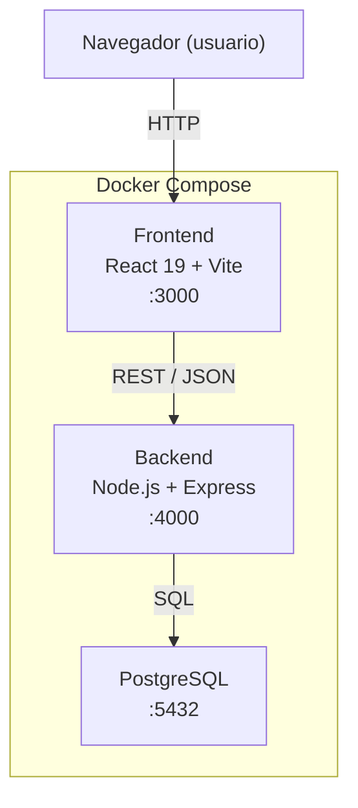
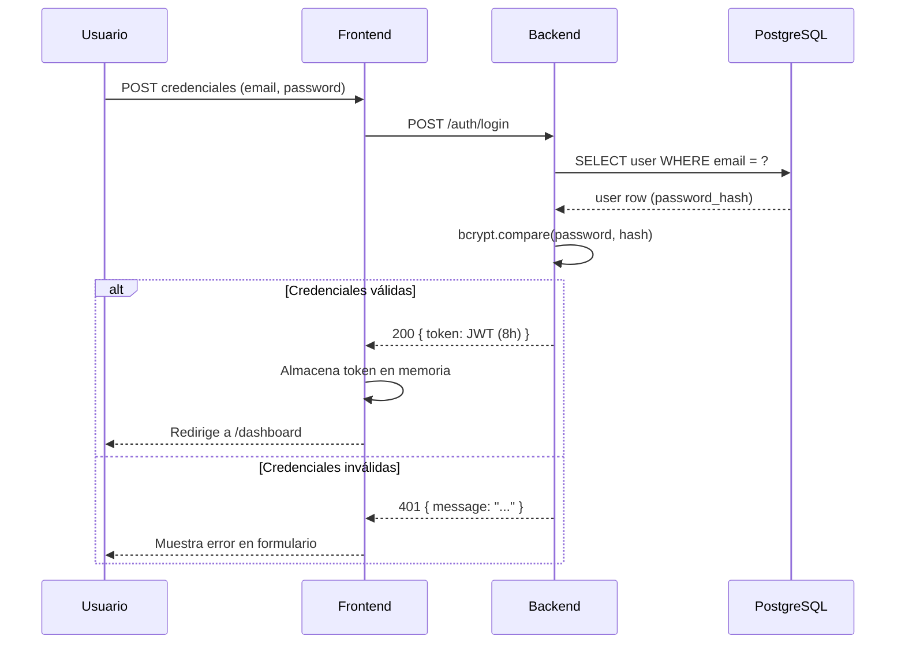

# Diseño Técnico: Veterinary Clinic Management

## Visión General

El sistema es una aplicación web de gestión de clínicas veterinarias compuesta por tres servicios orquestados con Docker Compose:

- **Frontend**: React 19 + Vite + TypeScript, sirve la UI en el puerto 3000.
- **Backend**: API REST Node.js/Express con autenticación JWT, expuesto en el puerto 4000.
- **Base de datos**: PostgreSQL, accesible solo desde la red interna de Docker.

El alcance inicial cubre la página de inicio pública, el flujo completo de autenticación JWT y un dashboard protegido. El frontend ya existe en `gestin-clinic/` y se extenderá con las nuevas páginas y lógica de autenticación.

---

## Arquitectura



### Flujo de autenticación



---

## Componentes e Interfaces

### Frontend

| Componente / Módulo | Responsabilidad |
|---|---|
| `HomePage` | Página pública con nombre del sistema, descripción y botón al login |
| `LoginPage` | Formulario de login (email + password), manejo de errores |
| `DashboardPage` | Página protegida, solo accesible con JWT válido |
| `ProtectedRoute` | HOC/wrapper que verifica el token antes de renderizar rutas privadas |
| `AuthContext` | React Context que expone `token`, `login()`, `logout()` a toda la app |
| `authService` | Módulo que encapsula las llamadas HTTP a `/auth/login` e `/auth/introspect` |

#### Rutas del frontend

| Ruta | Componente | Acceso |
|---|---|---|
| `/` | `HomePage` | Público |
| `/login` | `LoginPage` | Público (redirige a `/dashboard` si ya autenticado) |
| `/dashboard` | `DashboardPage` | Protegido — requiere JWT válido |

#### Gestión del token en memoria

El JWT se almacena **exclusivamente en memoria** (variable de estado en `AuthContext`), no en `localStorage` ni `sessionStorage`, para reducir la superficie de ataque XSS. Al recargar la página el usuario deberá re-autenticarse, o bien el frontend puede llamar a `/auth/introspect` con un refresh token en el futuro.

Al montar la app, si existe un token en memoria, se llama a `POST /auth/introspect` para verificar que sigue siendo válido. Si devuelve 401, se limpia el estado y se redirige al login.

### Backend

| Módulo | Responsabilidad |
|---|---|
| `app.ts` | Configuración de Express, middlewares globales (CORS, JSON parser) |
| `auth/router.ts` | Define las rutas: `POST /auth/login`, `POST /auth/introspect` |
| `auth/controller.ts` | Lógica de los handlers HTTP |
| `auth/service.ts` | Lógica de negocio: validar credenciales, firmar JWT, verificar JWT |
| `auth/middleware.ts` | Middleware `requireAuth` que valida el header `Authorization: Bearer <token>` |
| `db/client.ts` | Pool de conexiones a PostgreSQL (usando `pg`) |
| `db/migrations/001_init.sql` | Script SQL de creación de la tabla `users` |

#### Endpoints de la API

| Método | Ruta | Auth requerida | Descripción |
|---|---|---|---|
| `POST` | `/auth/login` | No | Valida credenciales, retorna JWT |
| `POST` | `/auth/introspect` | No | Valida un JWT, retorna payload del usuario |

---

## Modelos de Datos

### Tabla `users` (PostgreSQL)

```sql
CREATE TABLE users (
    id            SERIAL PRIMARY KEY,
    email         VARCHAR(255) NOT NULL UNIQUE,
    password_hash VARCHAR(255) NOT NULL,
    created_at    TIMESTAMPTZ  NOT NULL DEFAULT NOW()
);
```

### JWT Payload

```json
{
  "sub": "1",
  "email": "usuario@ejemplo.com",
  "iat": 1700000000,
  "exp": 1700028800
}
```

- `sub`: ID del usuario (string)
- `email`: correo del usuario
- `iat`: issued at (Unix timestamp)
- `exp`: expira 8 horas después de `iat`

### DTOs de la API

**POST /auth/login — Request**
```json
{ "email": "string", "password": "string" }
```

**POST /auth/login — Response 200**
```json
{ "token": "eyJ..." }
```

**POST /auth/introspect — Request**
```json
{ "token": "eyJ..." }
```

**POST /auth/introspect — Response 200**
```json
{ "sub": "1", "email": "usuario@ejemplo.com", "iat": 0, "exp": 0 }
```

### Variables de entorno (`.env.example`)

```env
# Base de datos
POSTGRES_USER=clinic_user
POSTGRES_PASSWORD=clinic_pass
POSTGRES_DB=clinic_db
DATABASE_URL=postgresql://clinic_user:clinic_pass@db:5432/clinic_db

# JWT
JWT_SECRET=change_me_in_production
JWT_EXPIRES_IN=8h

# Backend
PORT=4000

# Frontend
VITE_API_URL=http://localhost:4000
```

---

## Infraestructura Docker

```yaml
# docker-compose.yml (estructura)
services:
  db:
    image: postgres:16-alpine
    environment: { POSTGRES_USER, POSTGRES_PASSWORD, POSTGRES_DB }
    volumes: [postgres_data:/var/lib/postgresql/data]
    healthcheck: pg_isready

  backend:
    build: ./backend
    ports: ["4000:4000"]
    depends_on:
      db: { condition: service_healthy }
    environment: { DATABASE_URL, JWT_SECRET, JWT_EXPIRES_IN, PORT }

  frontend:
    build: ./gestin-clinic
    ports: ["3000:3000"]
    depends_on: [backend]
    environment: { VITE_API_URL }
```

El servicio `backend` usa `depends_on` con `condition: service_healthy` sobre `db` para garantizar que PostgreSQL esté listo antes de que el backend intente conectarse.


---

## Propiedades de Corrección

*Una propiedad es una característica o comportamiento que debe cumplirse en todas las ejecuciones válidas del sistema — esencialmente, una declaración formal sobre lo que el sistema debe hacer. Las propiedades sirven como puente entre las especificaciones legibles por humanos y las garantías de corrección verificables automáticamente.*

### Propiedad 1: El JWT generado expira exactamente en 8 horas

*Para cualquier* usuario válido que inicie sesión correctamente, el token JWT retornado por `POST /auth/login` debe tener un campo `exp` que sea exactamente `iat + 8 * 3600` segundos.

**Valida: Requisito 2.2**

---

### Propiedad 2: Credenciales inválidas siempre retornan 401

*Para cualquier* combinación de credenciales inválidas (email inexistente, contraseña incorrecta, campos vacíos), `POST /auth/login` debe retornar HTTP 401 con un mensaje de error no vacío.

**Valida: Requisito 2.3**

---

### Propiedad 3: Las contraseñas se almacenan como hash bcrypt válido

*Para cualquier* contraseña en texto plano, el valor almacenado en `password_hash` debe ser un hash bcrypt válido tal que `bcrypt.compare(password, hash)` retorne `true`, y el hash nunca debe ser igual a la contraseña original.

**Valida: Requisito 2.7**

---

### Propiedad 4: Las rutas protegidas redirigen al login sin token válido

*Para cualquier* ruta protegida del frontend, intentar acceder sin un token en el `AuthContext` (o con un token expirado) debe resultar en una redirección a `/login` y el token debe quedar limpiado del estado.

**Valida: Requisitos 2.5, 3.1**

---

### Propiedad 5: El middleware de autenticación valida correctamente el JWT

*Para cualquier* endpoint protegido de la API, una petición con un header `Authorization: Bearer <token>` inválido, malformado o expirado debe retornar HTTP 401; y una petición con un JWT válido debe retornar el recurso solicitado (no 401).

**Valida: Requisitos 3.2, 3.3**

---

### Propiedad 6: Introspect retorna los datos del usuario para tokens válidos

*Para cualquier* JWT válido y no expirado generado por el sistema, `POST /auth/introspect` debe retornar HTTP 200 con exactamente los mismos datos (`sub`, `email`) que fueron codificados en el token.

**Valida: Requisito 4.2**

---

### Propiedad 7: Introspect rechaza tokens inválidos o expirados

*Para cualquier* string que sea un JWT inválido, malformado o expirado, `POST /auth/introspect` debe retornar HTTP 401 con un mensaje descriptivo no vacío.

**Valida: Requisito 4.3**

---

### Propiedad 8: El email de usuario es único en la base de datos

*Para cualquier* dirección de email ya registrada en la tabla `users`, intentar registrar un segundo usuario con ese mismo email debe resultar en un error de restricción de unicidad en la DB y en un HTTP 409 retornado por la API.

**Valida: Requisitos 5.2, 5.3**

---

## Manejo de Errores

| Escenario | Capa | Respuesta |
|---|---|---|
| Credenciales inválidas en login | Backend | HTTP 401 `{ "message": "Credenciales inválidas" }` |
| JWT ausente o malformado en header | Backend (middleware) | HTTP 401 `{ "message": "Token requerido" }` |
| JWT expirado en header | Backend (middleware) | HTTP 401 `{ "message": "Token expirado" }` |
| JWT inválido en `/auth/introspect` | Backend | HTTP 401 `{ "message": "Token inválido o expirado" }` |
| Email duplicado en registro | Backend | HTTP 409 `{ "message": "El email ya está registrado" }` |
| Error de conexión a DB | Backend | HTTP 500 `{ "message": "Error interno del servidor" }` |
| Token expirado detectado en frontend | Frontend | Limpia `AuthContext`, redirige a `/login` |
| Acceso a ruta protegida sin token | Frontend | Redirige a `/login` |

**Principios:**
- Los errores del backend nunca exponen detalles internos (stack traces, queries SQL) en producción.
- El frontend muestra mensajes de error amigables al usuario, no los mensajes técnicos del backend directamente.
- Los errores de red (fetch fallido) se capturan y muestran un mensaje genérico de conectividad.

---

## Estrategia de Testing

### Enfoque dual: tests unitarios + tests basados en propiedades

El proyecto usa **Vitest** (ya compatible con el stack Vite/TypeScript) para tests unitarios en frontend y backend. Para property-based testing se usa **fast-check**, una librería madura para JavaScript/TypeScript.

### Tests unitarios (ejemplos concretos)

Se enfocan en:
- Presencia de elementos UI en componentes (`HomePage`, `LoginPage`, `DashboardPage`)
- Comportamiento de navegación al hacer clic en botones
- Comportamiento del formulario de login (submit, errores, redirección)
- Comportamiento de logout
- Presencia del dashboard tras autenticación exitosa

### Tests basados en propiedades (fast-check)

Cada test de propiedad se ejecuta con **mínimo 100 iteraciones**. Cada test incluye un comentario de trazabilidad con el formato:

`// Feature: veterinary-clinic-management, Property N: <texto de la propiedad>`

| Propiedad | Generadores | Qué varía |
|---|---|---|
| P1: JWT expira en 8h | Usuarios válidos aleatorios | email, id de usuario |
| P2: Credenciales inválidas → 401 | Pares (email, password) inválidos | email inexistente, password incorrecto, campos vacíos |
| P3: Contraseñas como bcrypt | Strings de contraseña arbitrarios | longitud, caracteres especiales, unicode |
| P4: Rutas protegidas redirigen | Rutas protegidas, estados de token | ruta, token expirado vs ausente |
| P5: Middleware JWT | Tokens inválidos / válidos | malformado, expirado, firma incorrecta |
| P6: Introspect válido → 200 | JWTs válidos generados por el sistema | diferentes usuarios, diferentes tiempos |
| P7: Introspect inválido → 401 | Strings arbitrarios como token | strings aleatorios, JWTs expirados, JWTs con firma alterada |
| P8: Email único | Emails arbitrarios | diferentes formatos de email válido |

### Tests de integración

- Levantar los tres servicios con `docker-compose up` y verificar que los puertos 3000 y 4000 responden.
- Flujo end-to-end: registro → login → acceso al dashboard → logout.

### Tests de humo (smoke tests)

- Verificar que `docker-compose.yml` define los tres servicios con la configuración correcta.
- Verificar que la tabla `users` existe con las columnas requeridas.
- Verificar que el endpoint `POST /auth/introspect` existe y acepta peticiones.
- Verificar que `.env.example` contiene todas las variables requeridas.
